<p align="center">
  
</p>

<p align="center">
  <b>A friendly, character-driven flight booking site.</b><br>
  Search → Pick → Pay → Fly, with no clutter in between.
</p>

<p align="center">
  
  
  
  
  
  
  
</p>

<p align="center">
  <a href="#-what-it-does">Features</a> ·
  <a href="#-screens">Screens</a> ·
  <a href="#-meet-the-cast">Characters</a> ·
  <a href="#-under-the-hood">Architecture</a> ·
  <a href="#-run-it-locally">Run locally</a> ·
  <a href="#-roadmap">Roadmap</a> ·
  <a href="#-türkçe">Türkçe</a>
</p>

<p align="center">
  
</p>

---

## ✨ What it does

Booking a flight shouldn't feel like filling in a tax form. pirpir keeps the whole journey to four steps and puts a small
character next to you at each one: Pırpır the little plane watches prices, Valiz the suitcase explains baggage, Biletçik the
boarding pass waits for your ticket.

<table>
<tr>
<td width="50%" valign="top">

### 🔎 Search
- Round trip or one way, cabin class, adults / children / infants
- **City search**: "Istanbul" searches IST + SAW, "London" every London airport
- **Flexible dates**: exact, ±1, ±3 or ±5 days
- Bags in the search itself, so prices already include them
- A price strip of nearby dates and a **price trends** chart
- **Price alerts** saved to your account

</td>
<td width="50%" valign="top">

### 🧭 Results
- **Best / Cheapest / Fastest / Direct only** sorting
- "Cheapest" and "Fastest" badges are computed, not hand-picked
- Layover city and waiting time on connecting flights
- Filters: bags, stops, overnight layovers, airlines (with lowest price), departure times, flight duration
- **Fare packages** (Basic / Plus / Flex…) side by side, with change and refund rules

</td>
</tr>
<tr>
<td valign="top">

### 🧳 Booking
- Per-passenger baggage with real weights (kg) and prices
- **Seat maps** with free, paid and extra-legroom seats
- Saved travellers and a searchable, localized nationality list
- Card number grouped in fours, card type detected as you type
- iDEAL bank list, Apple Pay and Google Pay options
- Discount codes in the price breakdown; pay button stays disabled until the terms are accepted

</td>
<td valign="top">

### 🎫 After booking
- Confirmation page with a full itinerary
- **PDF travel plan** with airline logos and baggage allowances
- **Calendar reminders**: `.ics` with alarms (1 day / 3 h / 1 h) or Google Calendar
- Share sheet for the trip
- **My trips**: upcoming / past / cancelled, countdown to departure, date change and cancellation

</td>
</tr>
<tr>
<td valign="top">

### 🌍 Made for everywhere
- **7 languages**: Türkçe, English, Nederlands, Deutsch, Français, Español, Italiano, each with localized URLs (`/en/search`, `/nl/zoeken`, `/de/suche`…)
- **16 countries**: each sets the default departure city and popular routes
- **12 currencies** with instant conversion on every page
- Brand name lives in one file (`src/config/brand.ts`)

</td>
<td valign="top">

### ♿ Built with care
- Real `<button>`, `<a>` and `<label>` elements; keyboard-friendly pickers
- Touch targets of at least 44 px, text contrast of at least 4.5:1
- Flags fall back to readable country codes on Windows
- Built from approved designs and checked side by side at 1440 px desktop and 390 px phone width

</td>
</tr>
</table>

## 📸 Screens

<p align="center">
  
</p>

<table>
<tr>
<td width="50%">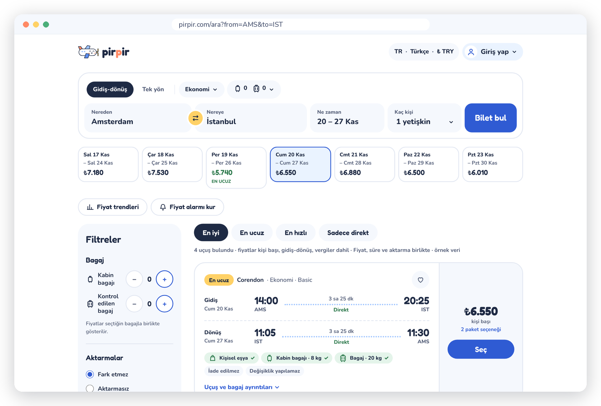<br><sub><b>Results</b>: sorting, filters, a date strip and computed badges</sub></td>
<td width="50%">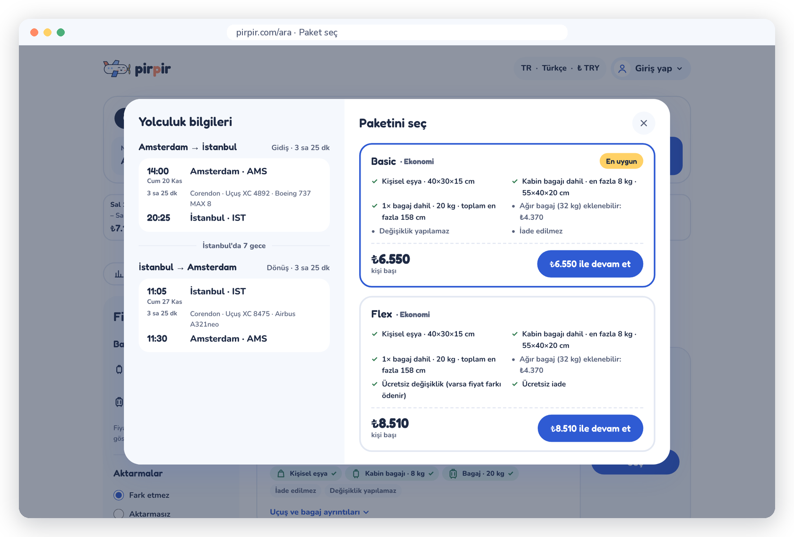<br><sub><b>Fare packages</b>: what is included, what costs extra</sub></td>
</tr>
<tr>
<td>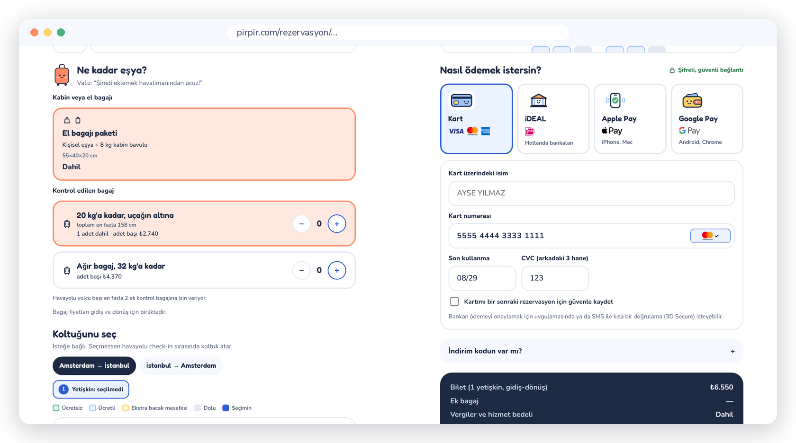<br><sub><b>Booking</b>: baggage by the kilo, seats and payment</sub></td>
<td>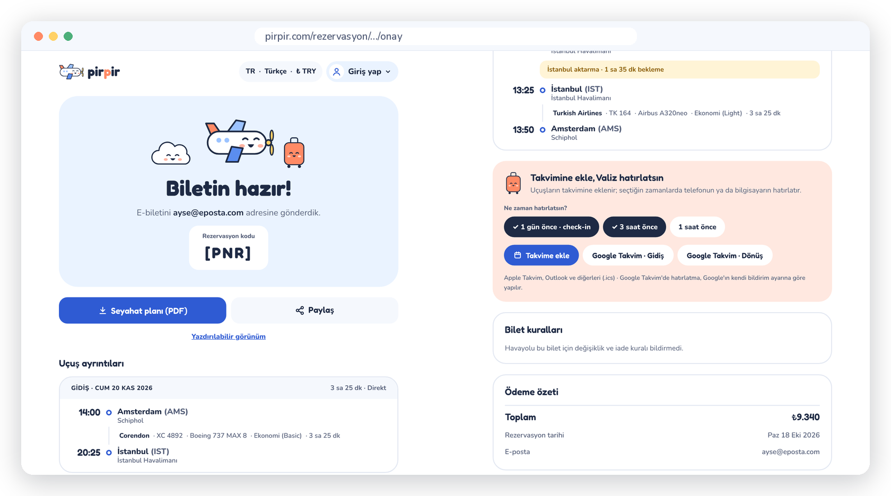<br><sub><b>Ticket ready</b>: itinerary, PDF, sharing and reminders</sub></td>
</tr>
<tr>
<td>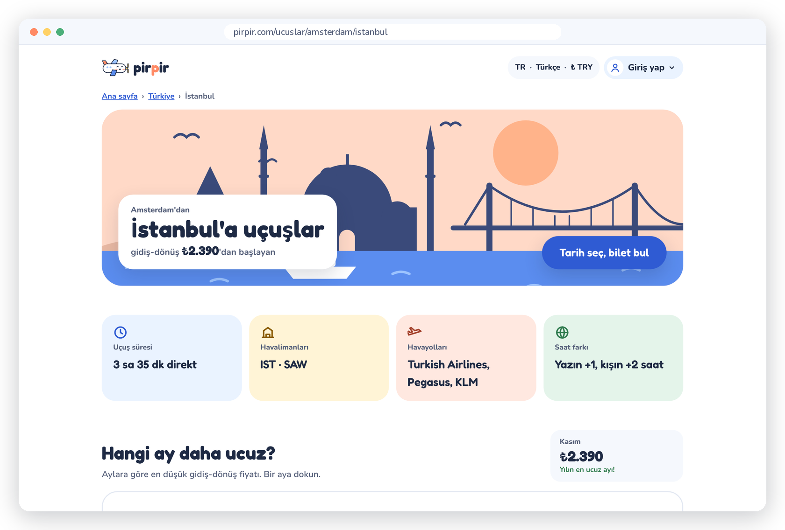<br><sub><b>Route pages</b>: statically generated for SEO</sub></td>
<td>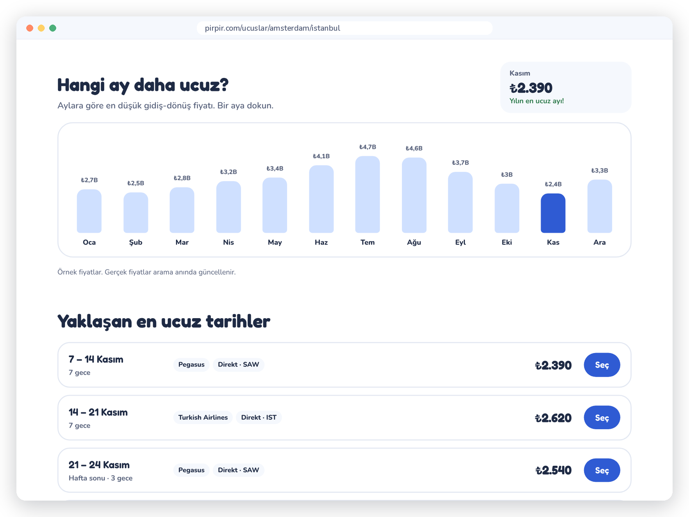<br><sub><b>Which month is cheapest?</b> Tap a bar to compare</sub></td>
</tr>
<tr>
<td>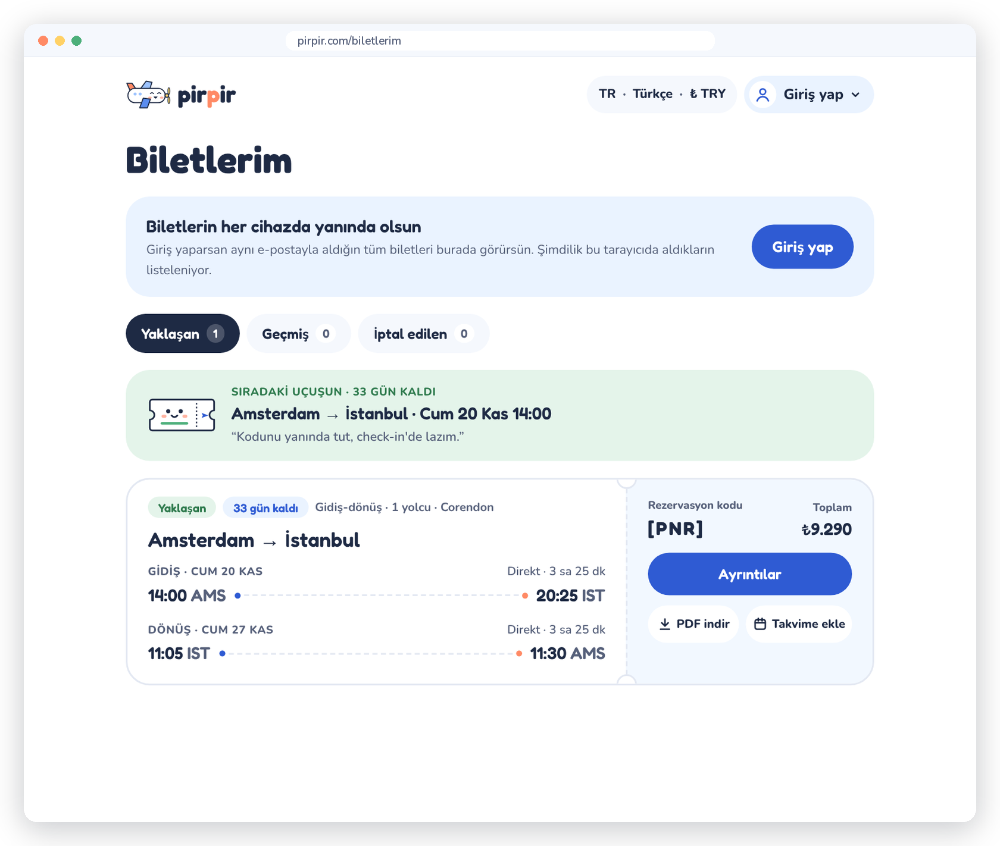<br><sub><b>My trips</b>: countdown, PDF and calendar in one place</sub></td>
<td>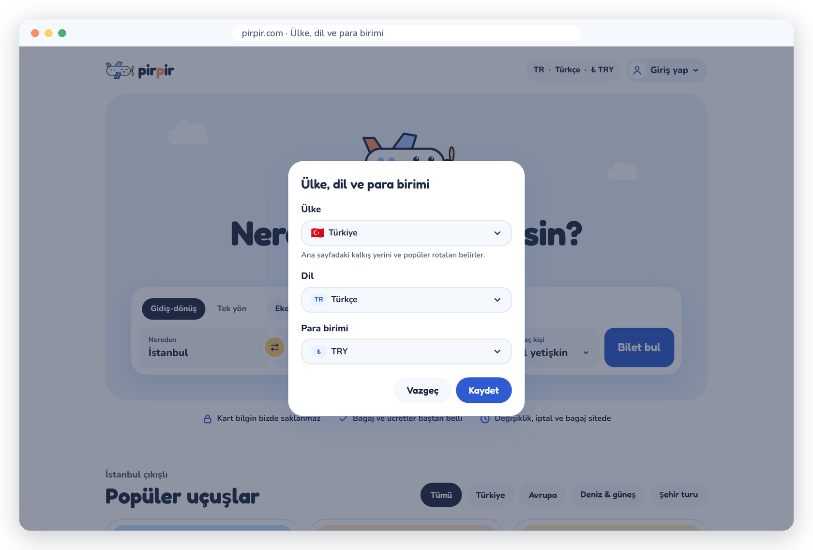<br><sub><b>Country · language · currency</b>, chosen independently</sub></td>
</tr>
</table>

<table>
<tr>
<td width="68%">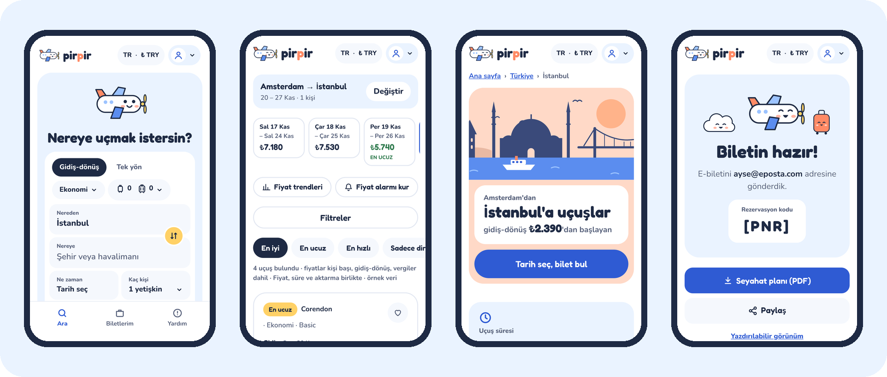<br><sub><b>On the phone</b>: every page is designed for 390 px first</sub></td>
<td width="32%">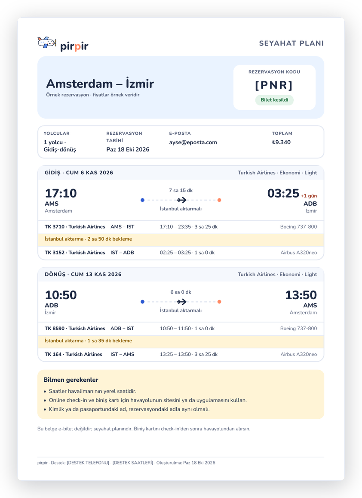<br><sub><b>PDF travel plan</b>, generated on the server</sub></td>
</tr>
</table>

> Prices in the screenshots are sample data. The site says so on the page too.

## 🧸 Meet the cast

<p align="center">
  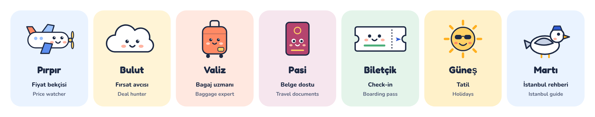
</p>

Every character shares the same navy outline and pink cheeks. A few house rules keep them charming instead of noisy: at most
two characters in one spot, and they always speak in short, quoted lines, like Valiz on the booking page:
*“Şimdi eklemek havalimanından ucuz!”* (adding it now is cheaper than at the airport).

## 🛠 Under the hood

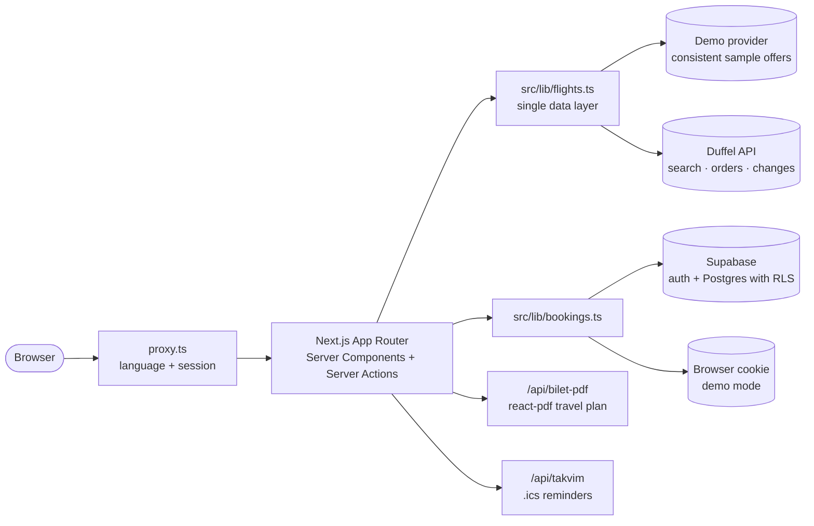

| | |
|---|---|
| **Framework** | Next.js 16 (App Router, Turbopack), React 19, TypeScript in strict mode |
| **Styling** | Tailwind CSS with design tokens in `tailwind.config.ts`; Fredoka + Nunito via `next/font` |
| **i18n** | `next-intl` with localized pathnames; every string lives in `messages/<lang>/*.json` |
| **Flights** | Duffel behind one data layer (`src/lib/flights.ts`); a deterministic demo provider when no key is set; cached searches with retry on temporary provider errors |
| **Accounts** | Supabase Auth (Google, Facebook, Apple, magic link) and Postgres with row-level security |
| **Documents** | `@react-pdf/renderer` for travel plans; `.ics` files and Google Calendar links for reminders |
| **Payments** | Planned with Mollie (card, iDEAL, Apple Pay, Google Pay in one integration). Card data never touches our server |

### Three data modes

| `DUFFEL_ACCESS_TOKEN` | Mode | Search | Booking |
|---|---|---|---|
| *(empty)* | **Demo** | Consistent sample offers for any route, date and passenger mix | Works end to end, no ticket issued |
| `duffel_test_…` | **Test** | Real offer structure from Duffel's sandbox | Orders paid from Duffel test balance, no real money |
| `duffel_live_…` | **Live** | Real flights | Disabled until payments are connected |

## 🚀 Run it locally

```bash
git clone https://github.com/samigulec/Pirpir.git
cd Pirpir
npm install
npm run dev        # http://localhost:3000
```

No keys are needed: without them the site runs in demo mode with sample flights and browser-only accounts.
To go further, copy `.env.example` to `.env.local` and add a Duffel test key and/or a Supabase project.

| Command | |
|---|---|
| `npm run dev` | Development server |
| `npm run build` | Production build |
| `npm run lint` | Type check |
| `npm run svg` | Regenerate React components from the SVGs in `assets/` |
| `npm run airports` | Rebuild the airport list |

Developer notes in Turkish (environment, Supabase setup, project layout) are in [`docs/GELISTIRME.md`](docs/GELISTIRME.md).

### Project layout

```
src/
├─ app/[locale]/        pages: home, search, route pages, booking, confirmation, my trips, account
├─ app/api/             PDF, calendar, prices, deals, places
├─ actions/             server actions: booking, auth, saved items
├─ components/          UI, plus characters/ cities/ payment/ drawn as SVG components
├─ lib/                 flights, currency, search, bookings, PDF, calendar
├─ config/              brand name, markets
└─ data/                airports, countries, sample data
messages/<lang>/        all interface text
design/                 approved designs (.dc.html), the source of truth
assets/                 original SVG drawings and fonts
supabase/migrations/    database schema
```

## 🗺 Roadmap

- [x] Every page, matched to the designs, on desktop and phone
- [x] Flight search, fares, seats and orders through Duffel (test mode)
- [x] Accounts, My trips, saved travellers, favourites and price alerts (Supabase)
- [x] PDF travel plan, calendar reminders, date change and cancellation
- [x] 7 languages, 16 countries, 12 currencies
- [ ] Payments with Mollie
- [ ] Price-drop emails: "Fiyat düşünce Pırpır sana haber versin"
- [ ] Live exchange rates
- [ ] Launch

---

## 🇹🇷 Türkçe

**pirpir**, sade ve sevimli bir uçak bileti sitesi: **Ara → Seç → Öde → Uç**. Her adımda küçük bir karakter yanında.
Pırpır fiyatları bekler, Valiz bagajı anlatır, Biletçik biletini bekler.

- **Arama:** gidiş-dönüş veya tek yön, şehir araması (İstanbul = IST + SAW), esnek tarihler (±1/3/5 gün), bagaj dahil fiyatlar, fiyat trendleri ve fiyat alarmı
- **Sonuçlar:** En iyi / En ucuz / En hızlı / Sadece direkt, otomatik rozetler, aktarma yeri ve bekleme süresi, ayrıntılı filtreler, paket karşılaştırma
- **Rezervasyon:** yolcu başına kilolu bagaj, koltuk haritası, kayıtlı yolcular, kart türü tanıma, iDEAL banka listesi, indirim kodu
- **Sonrası:** PDF seyahat planı, takvim hatırlatıcıları, paylaşma, Biletlerim (tarih değiştirme ve iptal)
- **Her yerde:** 7 dil, 16 ülke, 12 para birimi

Çalıştırmak için yukarıdaki komutlar yeterli; anahtar olmadan site örnek veriyle uçtan uca çalışır.
Ayrıntılı geliştirici notları: [`docs/GELISTIRME.md`](docs/GELISTIRME.md) · Proje kuralları: [`CLAUDE.md`](CLAUDE.md).
